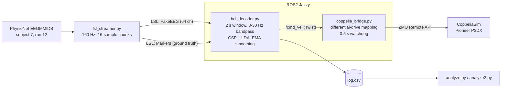

# Real-Time ROS2 BCI Teleoperation Loop

A simulated closed-loop brain-computer interface. Pre-recorded EEG from the PhysioNet EEG Motor Movement/Imagery Dataset is streamed over Lab Streaming Layer (LSL) as if it were a live subject. A ROS2 node decodes it with CSP + LDA, and the resulting left / right / rest decisions steer a simulated Pioneer P3DX robot in CoppeliaSim through `/cmd_vel`.

> **Demo video:** `demo.mp4` (add your screen recording here)

## Architecture



**Command mapping**

| Decoded class | `linear.x` | `angular.z` | Robot behaviour |
|---|---|---|---|
| Rest (T0) | 0.30 m/s | 0 | straight |
| Left imagery (T1) | 0.30 m/s | +0.35 rad/s | curves left |
| Right imagery (T2) | 0.30 m/s | -0.35 rad/s | curves right |

A class triggers a turn only when its smoothed probability exceeds `THRESH` (0.50).

## Method

- **Data:** EEGMMIDB, subject 7. Runs 4 and 8 (left vs. right fist imagery, plus rest) are used for training. Run 12 is held out and is the stream the robot sees.
- **Preprocessing:** 8-30 Hz Butterworth bandpass (4th order, zero-phase), 2 s sliding windows. The same `features.py` is imported by training and live inference to avoid train/serve mismatch.
- **Classifier:** 3-class CSP (6 components, OAS regularisation, log-variance) followed by LDA.
- **Online loop:** a decision every 0.25 s (40 samples), exponential moving average with `ALPHA = 0.3`.
- **Subject selection:** 20 subjects were scanned with the same pipeline (`scan_subjects.py`). Subject 7 scored highest (0.93 on 2 classes). **This selection makes the reported numbers optimistic for an unseen user.**

## Results

All live numbers come from replaying held-out run 12 through the full closed loop. The streamer loops one recording, so repeated runs are **not independent samples**.

| Metric | Value |
|---|---|
| Offline held-out accuracy, 3 classes (90 crops) | 0.756 |
| Live per-decision accuracy | 0.65-0.66 (0.71-0.73 after 1 s settling) |
| Live balanced accuracy | about 0.61 |
| Trial-level accuracy (majority vote after 1 s) | 0.77-0.80 |
| Always-rest baseline | about 0.50 |
| Right cues detected | 83% (median latency 0.9 s, p90 about 2 s) |
| Left cues detected | 57-71% |
| Right cues where the first turn went the wrong way | 22% (4 of 18) |
| Estimated ITR (Wolpaw, 3 classes) | 8-9 bits/min |

Live decision confusion matrix (THRESH 0.50, rows = truth):

|  | rest | left | right |
|---|---|---|---|
| **rest** | 352 | 50 | 46 |
| **left** | 104 | 95 | 0 |
| **right** | 95 | 13 | 140 |

The decoder is conservative: most errors are imagery being called rest, not turns in the wrong direction. The left-cue latency (0.0-0.15 s) is not reported, because smoothed probabilities carry over from the previous segment and make it physically implausible.

### Negative results

| Experiment | Result |
|---|---|
| Gate threshold 0.40 vs. 0.50 | no meaningful change (within noise) |
| 17 sensorimotor channels instead of 64 | 0.744 vs. 0.756; left recall dropped to 0.33 |
| Pooling 19 other subjects, no calibration | 0.50, collapsed to always predicting rest |

## Limitations

- Single subject, chosen after scanning 20, and a single held-out run (about 30 left/right cues). Confidence intervals are wide.
- Simulated "live" feed: no real hardware, no real-time artefacts, no user feedback effects.
- Offline crops are cleaner than the continuous stream, so live accuracy is lower than offline accuracy.
- End-to-end delay is roughly half the window plus the decision step plus smoothing, about 1 to 1.5 s.
- Plain CSP+LDA does not transfer between subjects without calibration.

## Setup (Ubuntu 24.04, ROS2 Jazzy, CoppeliaSim 4.10 Edu)

```bash
python3 -m venv --system-site-packages ~/bci_env
source ~/bci_env/bin/activate
pip install mne scikit-learn scipy joblib pylsl coppeliasim-zmqremoteapi-client
```

Every terminal needs:

```bash
source /opt/ros/jazzy/setup.bash
source ~/bci_env/bin/activate
cd ~/bci_project
```

In CoppeliaSim, drag **robots > mobile > Pioneer p3dx** into the scene, then run `python3 disable_script.py` so the model's built-in controller does not fight the BCI commands. Save the scene.

## Run

```bash
python3 train.py              # 1. train, saves csp_lda.joblib
# CoppeliaSim open with the Pioneer scene (do not press Play yet)
python3 lsl_streamer.py       # 2. terminal 1: fake live EEG
python3 bci_decoder.py        # 3. terminal 2: decoder, writes log.csv
python3 coppelia_bridge.py    # 4. terminal 3: waits for "Bridge ready"
# 5. press Play in CoppeliaSim
```

Evaluate a run (copy `log.csv` first, since each decoder start overwrites it):

```bash
cp log.csv log_run1.csv
python3 analyze.py            # confusion matrix, accuracy
python3 analyze2.py log_run1.csv   # per-cue detection, latency, ITR
```

## Files

| File | Purpose |
|---|---|
| `features.py` | shared bandpass filter and window constants |
| `train.py` | trains the 3-class CSP+LDA model |
| `scan_subjects.py` | scores subjects 1-20 to choose a demo subject |
| `train_more.py` | experiments: extra runs, channel subsets, multi-subject pooling |
| `lsl_streamer.py` | streams EEG and ground-truth markers over LSL in real time |
| `bci_decoder.py` | ROS2 node: LSL in, classification, `/cmd_vel` out, CSV log |
| `coppelia_bridge.py` | ROS2 node: `/cmd_vel` to wheel velocities in CoppeliaSim |
| `disable_script.py` / `list_scene.py` | CoppeliaSim helpers |
| `analyze.py` / `analyze2.py` | live-run evaluation |

## Possible extensions

- Train on the real-movement runs (3, 7, 11) in addition to imagery for more data from the same subject.
- Few-shot calibration: pretrain on many subjects, then fit LDA on a handful of target trials.
- Swap the mobile base for a robotic arm, mapping left/right to joint increments.
- Live dashboard of class probabilities.

## Data

Goldberger et al., PhysioBank, PhysioToolkit, and PhysioNet (2000). Schalk et al., BCI2000 (2004). EEG Motor Movement/Imagery Dataset v1.0.0, https://physionet.org/content/eegmmidb/1.0.0/
